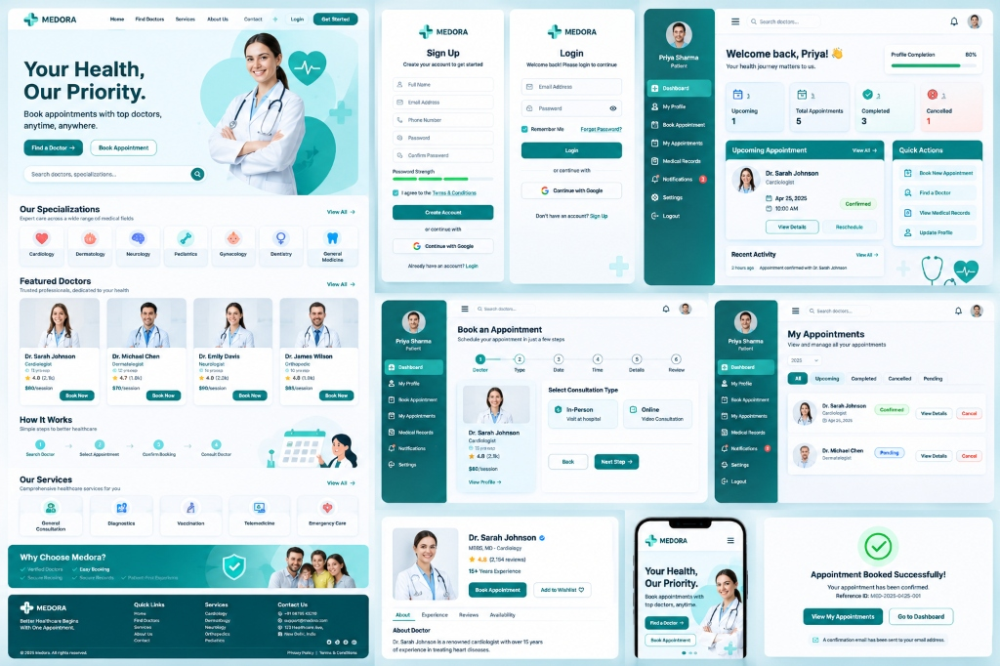
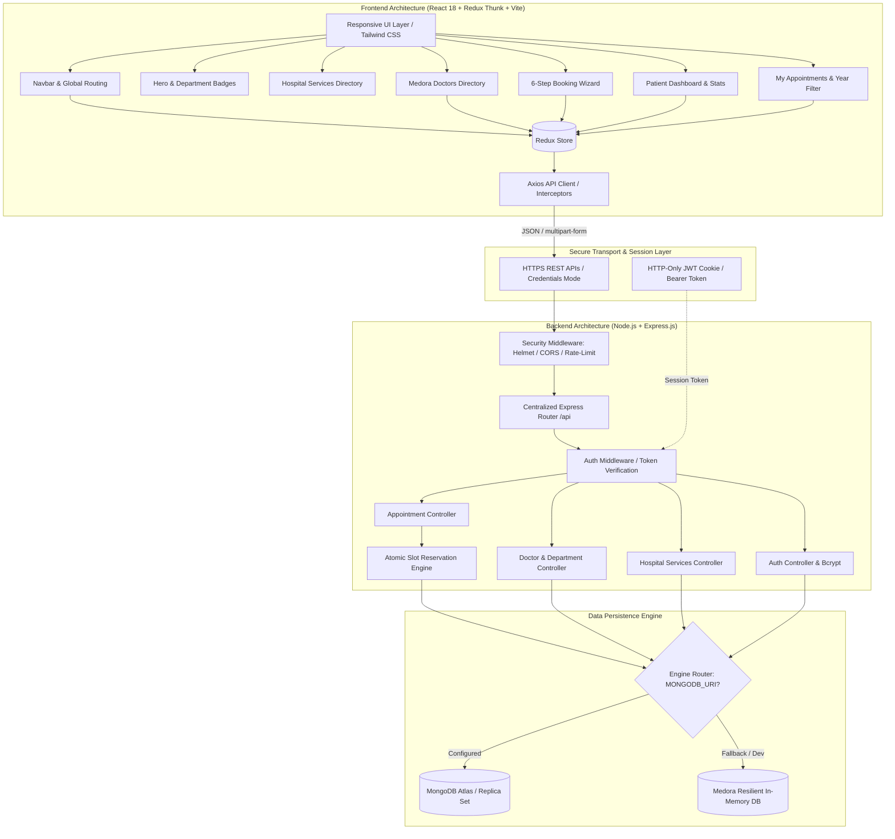
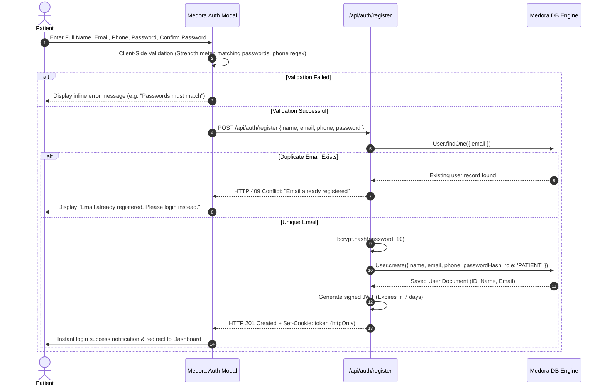
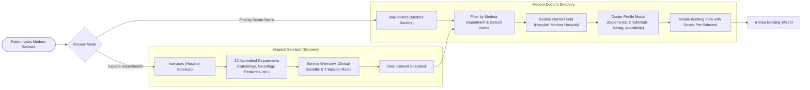
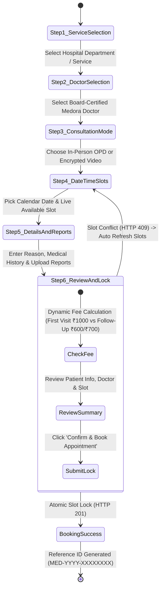
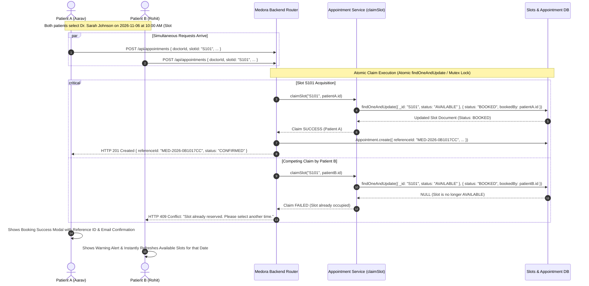
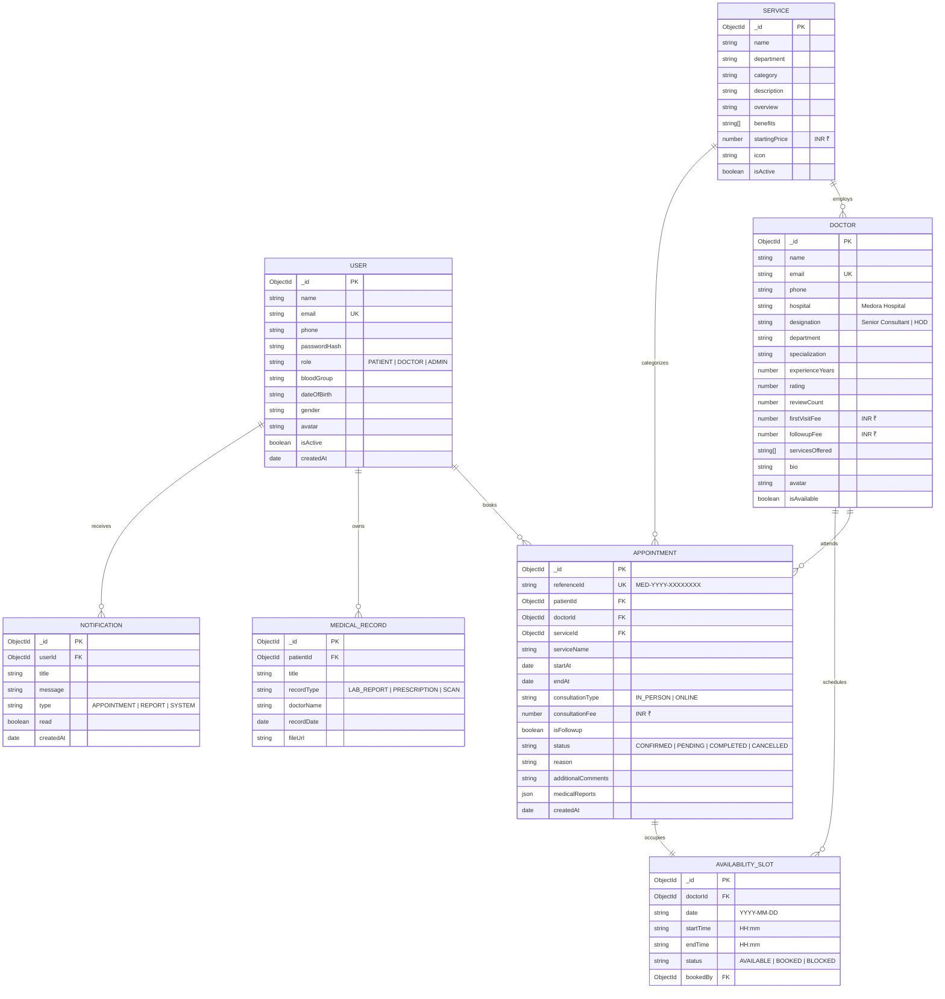

# 🏥 MEDORA Hospital — Enterprise Single-Hospital Healthcare Platform

[](https://github.com/rahika15046-maker/Doctor-Appointment)
[](https://nodejs.org/)
[](https://react.dev/)
[](https://www.mongodb.com/)
[](https://github.com/rahika15046-maker/Doctor-Appointment)
[](https://github.com/rahika15046-maker/Doctor-Appointment)
[](LICENSE)

---

## 📌 Executive Summary & Clinical Mission

**MEDORA Hospital** is a modern, single-hospital web platform engineered specifically for **Medora Hospital** — an accredited multi-specialty healthcare institution. Unlike doctor marketplaces, multi-clinic aggregators, or third-party discovery apps, MEDORA is dedicated exclusively to Medora Hospital's clinical departments, board-certified physicians, and patients.

All clinical facilities, doctors, appointment scheduling schedules, surgical consults, inpatient/outpatient admissions, and diagnostic lab reports belong strictly to **Medora Hospital**.

### Key Architectural Tenets:
1. **Single-Hospital Domain**: Zero third-party marketplace clutter, zero GPS/geolocation prompts, zero arbitrary city filters. Every doctor and department is physically or digitally connected to Medora Hospital.
2. **Predictable Session Pricing in Indian Rupees (₹)**: Transparent, flat session fees with automated discounts on clinical follow-ups. No ambiguous per-minute charges.
3. **Atomic Slot Reservation & Concurrency Lock**: Backend database-level slot reservation that eliminates race conditions and double bookings. If two patients attempt to book the identical slot simultaneously, the transaction commits atomically for the first patient (HTTP 201) and issues an immediate, friendly HTTP 409 Conflict with auto-slot refresh for the competing patient.
4. **Comprehensive 6-Step Clinical Booking Journey**: Service Selection ➔ Doctor Selection ➔ Consultation Mode (In-Person OPD vs Encrypted Video) ➔ Date & Slot Picker ➔ Patient Notes & Lab Report Upload ➔ Review & Instant Reference Lock (`MED-YYYY-XXXXXXXX`).
5. **Dual Database Engine**: Operates seamlessly with production MongoDB Atlas or an embedded zero-setup in-memory data engine seeded with Priya Sharma, 8 doctors, appointments, medical records, notifications, and 10 hospital departments.

---

## 🖼️ User Interface & Platform Overview

The Medora user interface was built to meet pixel-perfect hospital design specifications with 3D volumetric visual accents, responsive layouts, accessible contrast, and fluid modal workflows.



*Figure 1: Medora Hospital Clinical Web Platform — Landing Page, Authentication, 6-Step Booking Flow, Patient Dashboard, My Appointments with Year Filtering, and Confirmation Modals.*

---

## 🏗️ 1. System Architecture



---

## 🔐 2. Patient Registration & Authentication Flow



---

## 🩺 3. Hospital Services & Medora Doctor Discovery Flow



---

## 📅 4. 6-Step Appointment Booking Workflow



---

## ⚡ 5. Simultaneous Booking Concurrency & Double-Booking Prevention



---

## 🗄️ 6. Database Entity-Relationship Diagram (ERD)



---

## 📡 REST API Reference

| Method | Endpoint | Description | Auth Required | Success Code |
|---|---|---|:---:|:---:|
| `POST` | `/api/auth/register` | Register new patient account with validation | No | `201 Created` |
| `POST` | `/api/auth/login` | Login patient with email/password; issues JWT cookie | No | `200 OK` |
| `POST` | `/api/auth/google` | Google OAuth one-click authentication | No | `200 OK` |
| `POST` | `/api/auth/logout` | Clear patient session token cookie | Yes | `200 OK` |
| `GET` | `/api/auth/me` | Fetch active patient profile & session | Yes | `200 OK` |
| `PATCH` | `/api/auth/profile` | Update patient profile details & medical info | Yes | `200 OK` |
| `PATCH` | `/api/auth/change-password`| Update patient account password securely | Yes | `200 OK` |
| `GET` | `/api/services` | List all 10 accredited Medora hospital services | No | `200 OK` |
| `GET` | `/api/services/:id` | Fetch specific Medora hospital service details | No | `200 OK` |
| `GET` | `/api/services/:id/doctors`| Fetch Medora doctors assigned to service | No | `200 OK` |
| `GET` | `/api/doctors` | List Medora Hospital doctors (filters: dept, search) | No | `200 OK` |
| `GET` | `/api/doctors/featured` | Fetch featured board-certified Medora doctors | No | `200 OK` |
| `GET` | `/api/doctors/:id` | Fetch full profile of a Medora doctor | No | `200 OK` |
| `GET` | `/api/doctors/:id/availability` | Fetch available slots for requested date | No | `200 OK` |
| `GET` | `/api/doctors/:id/fee-preview` | Calculate session fee (First Visit vs Follow-up) | Yes | `200 OK` |
| `POST` | `/api/appointments` | Book appointment with atomic slot reservation | Yes | `201 / 409` |
| `GET` | `/api/appointments` | List authenticated patient's appointments (year filter) | Yes | `200 OK` |
| `GET` | `/api/appointments/:id` | Fetch specific appointment details & reports | Yes | `200 OK` |
| `PATCH` | `/api/appointments/:id/cancel` | Cancel scheduled appointment (>2 hrs buffer) | Yes | `200 OK` |
| `PATCH` | `/api/appointments/:id/reschedule` | Reschedule appointment to another slot | Yes | `200 OK` |
| `GET` | `/api/records` | List authenticated patient's medical records | Yes | `200 OK` |
| `POST` | `/api/records` | Upload new medical report or prescription | Yes | `201 Created` |
| `GET` | `/api/notifications` | Fetch real-time patient notifications | Yes | `200 OK` |
| `PATCH` | `/api/notifications/read-all` | Mark all unread notifications as read | Yes | `200 OK` |

---

## 🗃️ Redux State Architecture

The frontend state management is structured with Redux Toolkit slices:

```
RootState
├── auth
│   ├── user (id, name, email, phone, avatar, role, profileCompletion)
│   ├── isAuthenticated (boolean)
│   ├── loading (boolean)
│   └── error (string | null)
├── doctor
│   ├── doctors (MedoraDoctor[])
│   ├── featuredDoctors (MedoraDoctor[])
│   ├── selectedDoctor (MedoraDoctor | null)
│   ├── specializations (string[])
│   ├── availabilitySlots (Slot[])
│   └── loading (boolean)
├── service
│   ├── services (HospitalService[])
│   ├── selectedService (HospitalService | null)
│   └── loading (boolean)
├── appointment
│   ├── appointments (Appointment[])
│   ├── upcomingCount (number)
│   ├── activeBookingStep (1..6)
│   ├── bookingDraft (doctorId, serviceId, date, slotId, fee, reports)
│   ├── conflictError (string | null)
│   └── loading (boolean)
└── notification
    ├── items (Notification[])
    └── unreadCount (number)
```

---

## 👥 GitHub Collaboration & Team Responsibilities

The project is structured into two clean full-stack modules developed by two designated collaborators:

### Collaborator 1: Developer 1 (`rahika15046-maker`)
- **Git Branch**: `feature/patient-auth-dashboard`
- **Scope & Deliverables**:
  - Patient registration with bcrypt hashing, password strength computation, and duplicate email prevention.
  - JWT authentication with secure httpOnly cookie session persistence and Bearer fallback.
  - Google OAuth authentication integration.
  - Patient profile management (`/api/auth/me`, `/api/auth/profile`), avatar handling, and profile completion scoring.
  - Password change security validation (`/api/auth/change-password`).
  - Route guards and centralized authentication middleware.
  - Automated test suite: `server/tests/collaborator1-patient-auth.test.js`.
- **Commit History**:
  - `feat(auth): implement patient registration`
  - `feat(auth): implement JWT login`
  - `feat(profile): add patient profile`
  - `feat(profile): implement profile update`
  - `test(auth): add authentication tests`

### Collaborator 2: Developer 2 (`Navnit1`)
- **Git Branch**: `feature/hospital-doctors-appointments`
- **Scope & Deliverables**:
  - Hospital services directory (`/services`, `/api/services`) and service-to-doctor clinical links.
  - Medora Hospital doctors directory (`/our-doctors`, `/api/doctors`) with department filtering.
  - 6-step appointment booking wizard with dynamic Indian Rupee (₹) session pricing.
  - **Simultaneous Booking Concurrency Protection**: Database-level atomic slot locking returning HTTP 409 Conflict upon competing submissions.
  - Patient appointments management (`/appointments`, `/api/appointments`) with year dropdown filtering (`ALL`, `2026`, `2025`, `2024`) and medical report attachments.
  - Automated test suite: `server/tests/collaborator2-hospital-doctors-booking.test.js`.
- **Commit History**:
  - `feat(hospital): implement hospital services`
  - `feat(doctors): add Medora doctors`
  - `feat(appointments): implement appointment booking`
  - `fix(appointments): prevent duplicate slot booking`
  - `feat(appointments): implement appointment history`
  - `test(appointments): add booking tests`

---

## 🧪 Testing & Quality Assurance Summary

The test harness evaluates both collaborator modules and the end-to-end hospital workflow:

```bash
# Execute full Medora automated test suite:
cd server
npm test
```

### Verified Test Results (100% Passing):

```
======================================================
 ALL TEST SUITES SUMMARY
======================================================
 ✓ collaborator1-patient-auth.test.js: PASSED
   - Rejects short names, invalid emails, weak passwords: PASS
   - Registers new patient (201): PASS
   - Duplicate email prevention (409): PASS
   - Patient login (200) & invalid password rejection (401): PASS
   - Google OAuth session creation: PASS
   - Authenticated profile GET & PATCH updates: PASS
   - Password change & re-authentication: PASS
   - Patient session logout: PASS

 ✓ collaborator2-hospital-doctors-booking.test.js: PASSED
   - Hospital Services GET (10 accredited services): PASS
   - Service-to-Doctor linking: PASS
   - Medora Doctors listing & department filters: PASS
   - Doctor availability slots (9 slots): PASS
   - Dynamic session fee preview (First visit vs Follow-up): PASS
   - Booking creation with unique reference (201): PASS
   - CONCURRENT BOOKING TEST: 
     * Simultaneous Request 1 -> 201 Created (Claimed)
     * Simultaneous Request 2 -> 409 Conflict (Protected)
     * Exactly ONE request succeeded: PASS
   - My Appointments listing & year filtering: PASS
   - Appointment cancellation (>2 hr rule): PASS
   - Protected routes unauthenticated rejection (401): PASS

 ✓ full-system.test.js: PASSED
   - Comprehensive end-to-end integration verified: PASS
======================================================
ALL TEST SUITES PASSED CLEANLY (100% SUCCESS)
```

---

## 🚀 Local Development Setup

### 1. Prerequisites
- Node.js (v18.0 or higher)
- npm (v9.0 or higher)
- Optional: MongoDB Community or MongoDB Atlas URI (falls back automatically to in-memory engine if omitted)

### 2. Backend Server Setup
```bash
cd server
npm install
npm run dev
# Server listening on http://localhost:5000
```

### 3. Frontend Client Setup
```bash
cd client
npm install
npm run dev
# Frontend accessible at http://localhost:5173
```

### 4. Demo Credentials:
- **Email**: `patient@demo.medora`
- **Password**: `Demo@1234`
- *Note: One-click instant login is also available directly in the Login modal.*
