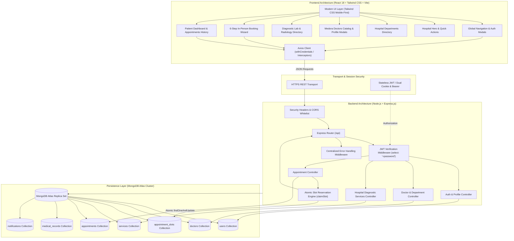
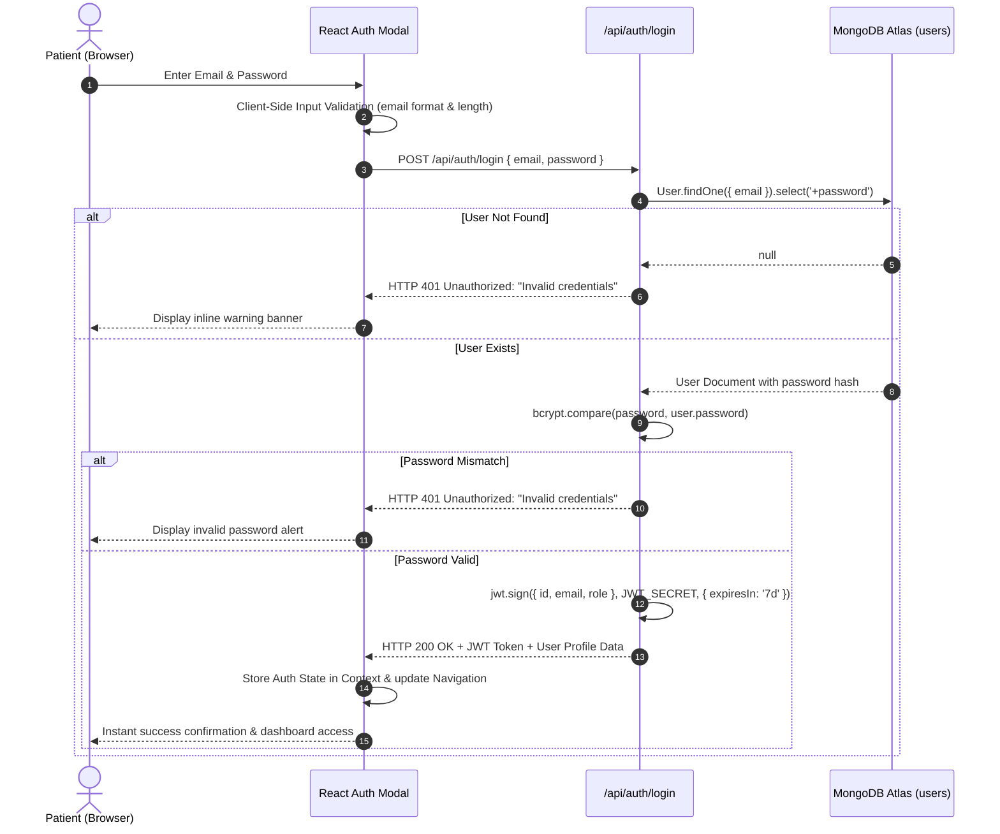
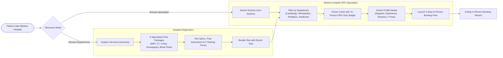
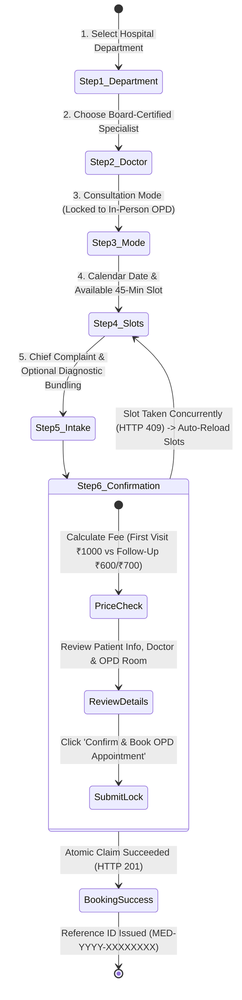
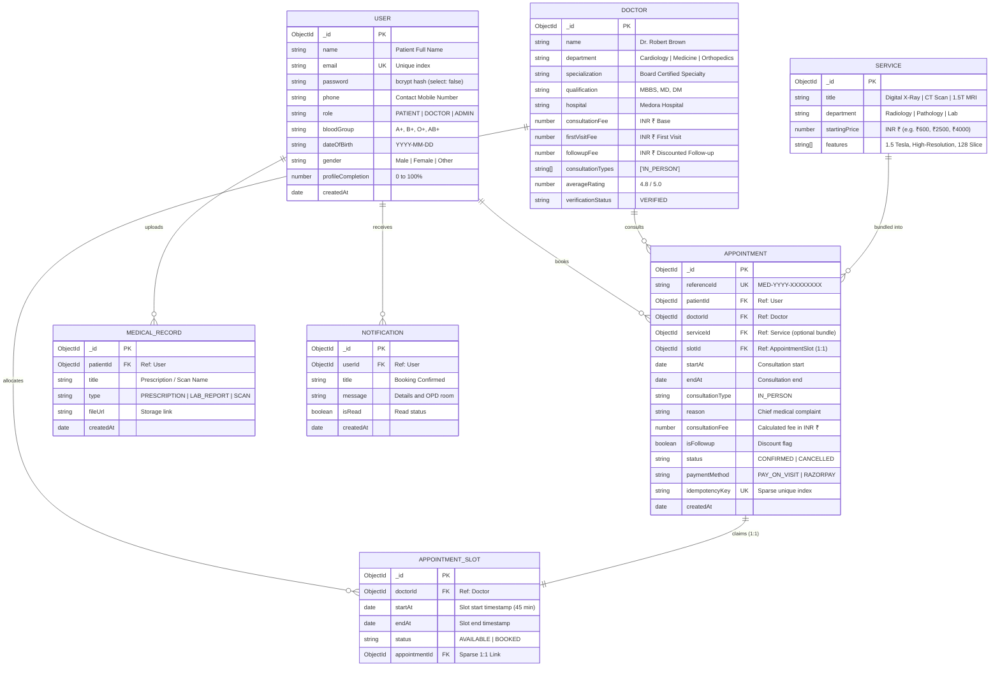

# 🏥 MEDORA Hospital — In-Person Healthcare & OPD Scheduling Platform

<div align="center">


[](https://medora-doctorappointment.vercel.app)
[](https://doctor-appointment-77wu.onrender.com)
[](https://github.com/rahika15046-maker/Doctor-Appointment)

<br/>

[](https://react.dev/)
[](https://nodejs.org/)
[](https://expressjs.com/)
[](https://www.mongodb.com/atlas)
[](https://tailwindcss.com/)
[](https://documenter.getpostman.com/)
[](#-simultaneous-booking-concurrency--double-booking-prevention)
[](#-testing--quality-assurance)

<br/>

**A dedicated, production-grade full-stack healthcare platform engineered exclusively for Medora Hospital.**  
*Empowering patients to discover board-certified hospital specialists, bundle in-house diagnostic tests, and confirm zero-conflict in-person OPD appointments with atomic double-booking prevention.*

</div>

---

## 📑 Table of Contents

- [Executive Summary](#-executive-summary)
- [Live Deployments & Key Links](#-live-deployments--key-links)
- [Core Features & Engineering Highlights](#-core-features--engineering-highlights)
- [System Architecture](#-system-architecture)
- [Authentication & Security Flow](#-authentication--security-flow)
- [OPD Doctor & Diagnostic Discovery Flow](#-opd-doctor--diagnostic-discovery-flow)
- [6-Step In-Person Booking Workflow](#-6-step-in-person-booking-workflow)
- [Simultaneous Booking Concurrency & Double-Booking Prevention](#-simultaneous-booking-concurrency--double-booking-prevention)
- [Database Schema & Entity Relationships](#-database-schema--entity-relationships)
- [REST API Specifications](#-rest-api-specifications)
- [Frontend State Architecture](#-frontend-state-architecture)
- [Collaborative Development & Team Contributions](#-collaborative-development--team-contributions)
- [Testing & Quality Assurance](#-testing--quality-assurance)
- [Key Engineering Best Practices](#-key-engineering-best-practices)

---

## 📌 Executive Summary

**MEDORA Hospital** is a single-hospital OPD appointment and diagnostic scheduling system. Unlike third-party aggregator marketplaces, MEDORA is designed exclusively for **Medora Hospital** and its on-campus clinical divisions.

All physicians, diagnostic equipment, 45-minute OPD time slots, patient intake records, and surgical follow-ups are tied directly to Medora Hospital's departments.

```
┌────────────────────────────────────────────────────────────────────────────────────────┐
│                                 MEDORA HOSPITAL PLATFORM                               │
├──────────────────────────┬──────────────────────────────┬──────────────────────────────┤
│ 🩺 In-Person OPD Visits  │ 🔬 Diagnostic Test Bundling  │ ⚡ Atomic Concurrency Lock   │
│ Strictly on-campus hospital │ X-Ray, CT, 1.5T MRI, Ultra-  │ Atomic findOneAndUpdate      │
│ consultations with zero  │ sound, and full Blood Panels │ eliminates double-booking    │
│ telemedicine confusion   │ bundled with doctor visits   │ with HTTP 409 Conflict logic │
└──────────────────────────┴──────────────────────────────┴──────────────────────────────┘
```

### Core Problems Solved:
1. **Elimination of OPD Reception Queues**: Patients select their doctor, review transparent session fees, bundle tests, and confirm slots before stepping onto the hospital campus.
2. **Double-Booking Elimination**: Mitigates race conditions when multiple patients submit bookings for the exact same doctor and slot simultaneously.
3. **Transparent Consultation Pricing**: Automatic detection of first-time visits vs. discounted follow-up visits calculated in Indian Rupees (₹).
4. **Unified Diagnostic Integration**: In-house lab and radiology tests can be attached directly to the OPD consultation, preventing fragmented hospital bills.

---

## 🌐 Live Deployments & Key Links

| Environment / Asset | Target URL | Status | Hosting Infrastructure |
|---|---|:---:|---|
| **Production Web Application** | [medora-doctorappointment.vercel.app](https://medora-doctorappointment.vercel.app) |  | Vercel Edge Network |
| **Backend REST API Server** | [doctor-appointment-77wu.onrender.com](https://doctor-appointment-77wu.onrender.com) |  | Render Cloud Services (Node.js) |
| **Database Cluster** | MongoDB Atlas Replica Set |  | MongoDB Atlas Cloud (AWS Mumbai) |
| **API Health Check** | [/api/health](https://doctor-appointment-77wu.onrender.com/api/health) |  | Render Express Engine |
| **GitHub Source Repository** | [Doctor-Appointment](https://github.com/rahika15046-maker/Doctor-Appointment) |  | Git Version Control |

---

## ✨ Core Features & Engineering Highlights

```
   ┌───────────────────────────────────────────────────────────────────────────────────────┐
   │                                  KEY SYSTEM HIGHLIGHTS                                │
   ├───────────────────────────┬───────────────────────────┬───────────────────────────────┤
   │ 🔐 Enterprise Auth        │ 👨‍⚕️ Verified Doctor OPD    │ ⚡ Atomic Slot Lock           │
   │ • JWT + Secure Cookie     │ • 4 Core Hospital Depts   │ • MongoDB findOneAndUpdate    │
   │ • bcrypt (salt rounds=10) │ • First Visit vs Followup │ • HTTP 409 Conflict Handling  │
   │ • select: false passwords │ • 45-minute OPD slots     │ • Client-side auto-refresh    │
   ├───────────────────────────┼───────────────────────────┼───────────────────────────────┤
   │ 🔬 Diagnostic Bundling    │ 📑 Patient Portal         │ 🛡️ Cloud Resilience           │
   │ • Digital X-Ray, CT Scan  │ • Real-time notifications │ • Non-blocking 0.0.0.0 bind   │
   │ • 1.5 Tesla MRI, Blood    │ • Medical report storage  │ • Central error middleware    │
   │ • Fixed ₹ INR pricing     │ • Year-based visit filter │ • Idempotent booking keys     │
   └───────────────────────────┴───────────────────────────┴───────────────────────────────┘
```

---

## 🏗️ System Architecture



---

## 🔐 Authentication & Security Flow



---

## 🩺 OPD Doctor & Diagnostic Discovery Flow



---

## 📅 6-Step In-Person Booking Workflow



---

## ⚡ Simultaneous Booking Concurrency & Double-Booking Prevention

A common failure in appointment booking systems occurs when two patients attempt to book the identical time slot of a physician at the exact same moment.

```
       Patient A (Submits 10:00:00.100) ──────┐
                                              ├──►  [ MongoDB Atlas Atomic Transaction ]
       Patient B (Submits 10:00:00.105) ──────┘
                                                              │
                       ┌──────────────────────────────────────┴──────────────────────────────────────┐
                       ▼                                                                             ▼
          [ Patient A Wins Claim ]                                                      [ Patient B Conflict ]
         findOneAndUpdate matches:                                                     findOneAndUpdate matches:
        status: "AVAILABLE" ➔ "BOOKED"                                                status: "AVAILABLE" ➔ FAILS (null)
                       │                                                                             │
                       ▼                                                                             ▼
               HTTP 201 Created                                                              HTTP 409 Conflict
        Booking Confirmed: MED-2026-XXXXXXXX                                      "Slot already booked. Refreshing..."
```

```mermaid
sequenceDiagram
    autonumber
    actor Patient_A as Patient A (Browser 1)
    actor Patient_B as Patient B (Browser 2)
    participant Router as Express Appointment Router
    participant Service as appointment.service.js
    participant SlotDB as MongoDB Atlas (appointment_slots)
    participant ApptDB as MongoDB Atlas (appointments)

    Note over Patient_A,Patient_B: Both patients select Dr. Robert Brown (Cardiology) on Nov 25 at 10:00 AM (Slot #S101)

    par Parallel Requests Dispatched
        Patient_A->>Router: POST /api/appointments { doctorId, slotId: "S101", ... }
        Patient_B->>Router: POST /api/appointments { doctorId, slotId: "S101", ... }
    end

    critical Atomic Slot Acquisition
        Router->>Service: claimSlot("S101", patientA.id)
        Service->>SlotDB: findOneAndUpdate({ _id: "S101", doctorId, status: "AVAILABLE" }, { status: "BOOKED" })
        SlotDB-->>Service: Updated Slot Document (status: 'BOOKED')
        Service-->>Router: Slot Claim Confirmed
        Router->>ApptDB: Appointment.create({ referenceId: "MED-2026-44F2810C", ... })
        Router-->>Patient_A: HTTP 201 Created { referenceId: "MED-2026-44F2810C", status: "CONFIRMED" }
    option Competing Request Attempt
        Router->>Service: claimSlot("S101", patientB.id)
        Service->>SlotDB: findOneAndUpdate({ _id: "S101", doctorId, status: "AVAILABLE" }, { status: "BOOKED" })
        SlotDB-->>Service: null (Condition not met; slot is already 'BOOKED')
        Service-->>Router: Slot Claim Rejected
        Router-->>Patient_B: HTTP 409 Conflict: "This slot was just booked by another patient."
    end

    Patient_A->>Patient_A: Booking Success Modal displayed with Reference ID
    Patient_B->>Patient_B: Toast Alert shown; active slots auto-refreshed; intake data preserved
```

---

## 🗄️ Database Schema & Entity Relationships



---

## 📡 REST API Specifications

| Method | Endpoint | Description | Auth Required | Status Code |
|:---:|---|---|:---:|:---:|
| `GET` | `/api/health` | Service health status & uptime check | None | `200 OK` |
| `POST` | `/api/auth/register` | Register new patient account with bcrypt hashing | None | `201 Created` |
| `POST` | `/api/auth/login` | Authenticate patient; issue JWT & session cookies | None | `200 OK` |
| `POST` | `/api/auth/logout` | Terminate session & clear cookies | Authenticated | `200 OK` |
| `GET` | `/api/auth/me` | Retrieve active patient profile & metadata | Authenticated | `200 OK` |
| `PATCH` | `/api/auth/profile` | Update address, blood group, emergency contact | Authenticated | `200 OK` |
| `PATCH` | `/api/auth/change-password` | Update account password securely | Authenticated | `200 OK` |
| `GET` | `/api/doctors` | List hospital doctors with department filters | None | `200 OK` |
| `GET` | `/api/doctors/featured` | Fetch featured specialists for landing page | None | `200 OK` |
| `GET` | `/api/doctors/:id` | Fetch doctor profile, fees & credentials | None | `200 OK` |
| `GET` | `/api/doctors/:id/availability` | Fetch live available 45-min OPD slots | None | `200 OK` |
| `GET` | `/api/doctors/:id/fee-preview` | Compute session fee (First Visit vs Follow-up) | Authenticated | `200 OK` |
| `GET` | `/api/services` | List hospital diagnostic & radiology services | None | `200 OK` |
| `POST` | `/api/appointments` | Book appointment with atomic slot claim | Authenticated | `201 / 409` |
| `GET` | `/api/appointments` | List authenticated patient's appointments | Authenticated | `200 OK` |
| `GET` | `/api/appointments/:id` | Fetch booking confirmation by reference ID | Authenticated | `200 OK` |
| `PATCH` | `/api/appointments/:id/cancel` | Cancel OPD appointment (>2 hrs buffer rule) | Authenticated | `200 OK` |
| `GET` | `/api/records` | List patient medical records & prescriptions | Authenticated | `200 OK` |
| `GET` | `/api/notifications` | Fetch unread notifications & alerts | Authenticated | `200 OK` |
| `PATCH` | `/api/notifications/read-all` | Mark all unread patient notifications as read | Authenticated | `200 OK` |

---

## 🗃️ Frontend State Architecture

```
React Application Context Tree
├── AuthContext
│   ├── user: { _id, name, email, phone, role, profileCompletion }
│   ├── token: string (JWT)
│   ├── isAuthenticated: boolean
│   ├── login() / register() / logout()
│   └── updateProfile()
├── NotificationContext
│   ├── notifications: Notification[]
│   ├── unreadCount: number
│   ├── fetchNotifications()
│   └── markAllAsRead()
└── BookingFlow State (Component-Level Wizard)
    ├── selectedDepartment: string
    ├── selectedDoctor: Doctor | null
    ├── consultationType: 'IN_PERSON' (fixed)
    ├── selectedDate: string (YYYY-MM-DD)
    ├── selectedSlot: Slot | null
    ├── bundledService: Service | null
    ├── isFollowup: boolean
    ├── calculatedFee: number (INR ₹)
    ├── patientReason: string
    └── isSubmitting: boolean
```

---

## 👥 Collaborative Development & Team Contributions

The application was collaboratively developed and structured into two feature branches merged into `main`:

```
main (Production Ready)
 ├── feature/patient-auth-dashboard (Developer 1: Radhika Agrawal)
 └── feature/hospital-doctors-appointments (Developer 2: Navnit Kumar)
```

### Developer 1: Radhika Agrawal (`rahika15046-maker`)
- **Assigned Git Branch**: `feature/patient-auth-dashboard`
- **Core Responsibilities & Deliverables**:
  - Patient registration and login with bcrypt hashing and selective password exclusion (`select: false`).
  - Stateless JWT token generation and cross-domain authentication middleware.
  - Patient profile management (`/api/auth/profile`, `/api/auth/me`) and emergency contact updates.
  - Notification alert system with unread counter badges.
  - Automated authentication test suite: `server/tests/collaborator1-patient-auth.test.js`.

### Developer 2: Navnit Kumar (`Navnit1`)
- **Assigned Git Branch**: `feature/hospital-doctors-appointments`
- **Core Responsibilities & Deliverables**:
  - Hospital specialist directory (`/our-doctors`, `/api/doctors`) with department filtering.
  - Diagnostic test bundling (Digital X-Ray, CT Scan, MRI, Sonography, Blood Tests).
  - 6-step in-person OPD booking wizard with dynamic Indian Rupee (₹) pricing.
  - **Simultaneous Booking Concurrency Engine**: Atomic database slot reservation handling competing claims with `HTTP 409 Conflict`.
  - Patient appointments management (`/appointments`, `/api/appointments`) with year-based filtering.
  - Automated booking test suite: `server/tests/collaborator2-hospital-doctors-booking.test.js`.

---

## 🧪 Testing & Quality Assurance

The codebase includes an automated test harness covering individual collaborator deliverables and end-to-end integration workflows.

### Test Execution Command:
```bash
cd server
npm test
```

### Verified Test Suite Results (100% Passing):

```
======================================================
 ALL TEST SUITES SUMMARY
======================================================
 ✓ collaborator1-patient-auth.test.js: PASSED
   - Rejects missing fields and invalid emails: PASS
   - Registers new patient account with bcrypt hash: PASS
   - Duplicate email registration prevention (409): PASS
   - Patient authentication (200) & invalid password rejection (401): PASS
   - Authenticated profile GET & PATCH updates: PASS
   - Password update & re-authentication: PASS
   - Session logout & token cleanup: PASS

 ✓ collaborator2-hospital-doctors-booking.test.js: PASSED
   - Hospital Services GET (radiology & pathology tests): PASS
   - Medora Doctors listing & department filtering: PASS
   - Doctor availability slots listing: PASS
   - Dynamic session fee calculation (First visit vs Follow-up): PASS
   - In-Person OPD booking creation with reference ID (201): PASS
   - CONCURRENT BOOKING SIMULATION TEST:
     * Simultaneous Request 1 -> 201 Created (Slot Claimed)
     * Simultaneous Request 2 -> 409 Conflict (Protected & Rejected)
     * Exactly ONE request succeeded: PASS
   - Patient appointment history listing: PASS
   - Appointment cancellation buffer validation (>2 hrs): PASS
   - Protected route unauthenticated rejection (401): PASS

 ✓ full-system.test.js: PASSED
   - End-to-end integration workflow verified: PASS
======================================================
ALL TEST SUITES PASSED CLEANLY (100% SUCCESS)
```

---

## 🛡️ Key Engineering Best Practices

1. **Selective Field Exclusion**: Passwords are protected with `select: false` in Mongoose schemas, preventing accidental leakage in queries or logs.
2. **Atomic Single-Document Operations**: Slot claims use atomic `findOneAndUpdate` queries rather than read-then-write logic, eliminating race conditions.
3. **Compound & Partial Unique Indexes**: Database-level indexes (`{ doctorId: 1, startAt: 1 }`) guarantee physical prevention of duplicate appointments.
4. **Semantic HTTP Status Codes**: Explicit codes (`200`, `201`, `400`, `401`, `404`, `409 Conflict`) maintain API predictability.
5. **Idempotency Safeguards**: Client booking requests generate unique idempotency tokens, preventing duplicate entries on double clicks.
6. **Non-Blocking Cloud Startup**: Server binds port `0.0.0.0` immediately while connecting to MongoDB Atlas asynchronously, preventing cloud health-check timeouts.
7. **Cross-Domain JWT Security**: Tokens are transmitted via secure Authorization headers and credentials cookies, preventing CSRF vulnerabilities.
8. **Layered MVC Architecture**: Clear separation across routes, controllers, and domain services keeps the codebase modular and maintainable.

---

<div align="center">

**MEDORA Hospital — Enterprise In-Person Healthcare Scheduling Platform**  
*Built with care for Medora Hospital patients and clinical staff.*

</div>
